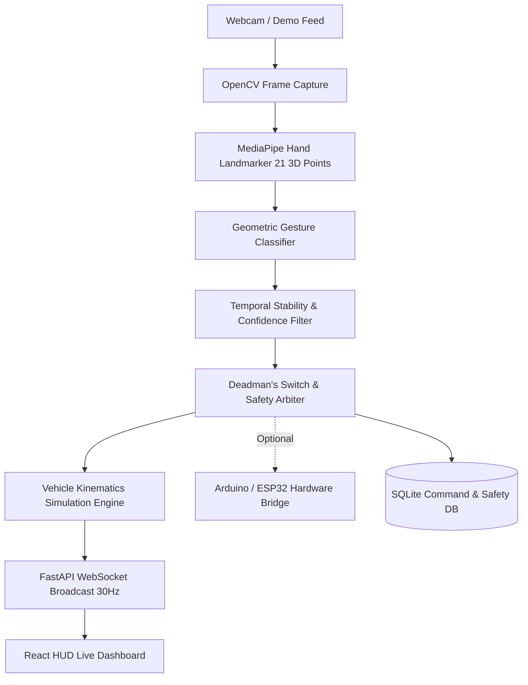

# AURA AI — Gesture-Controlled Smart Vehicle System

An intelligent, safety-critical vehicle control system that recognizes hand gestures in real time using computer vision and translates them into vehicle kinematics commands. Features a cybernetic automotive HUD dashboard with interactive 2D physics simulation, live webcam landmark overlays, temporal stability filtering, deadman's automatic stop, persistent SQLite command auditing, and an optional Arduino / ESP32 hardware serial bridge.

---

## System Architecture Pipeline



---

## 1. Supported Gestures & Default Vehicle Commands

| # | Gesture Name | Target Vehicle Command | Description & Safety Logic |
|---|---|---|---|
| **1** | **Open Palm** | `STOP` | Normal deceleration and safe braking to complete stop |
| **2** | **Closed Fist** | `EMERGENCY_STOP` | **Highest Priority:** Instant halt, locks vehicle in E-Stop until reset |
| **3** | **Thumb Up** | `START_SIMULATION` | Starts engine into Drive (`D`) or clears Emergency Stop |
| **4** | **Index Forward** | `FORWARD` | Accelerates vehicle forward up to mode speed limit |
| **5** | **Index Backward / Down** | `REVERSE` | Reverses vehicle backwards in gear `R` |
| **6** | **Hand Tilted Left** | `TURN_LEFT` | Steers vehicle wheels left (-35°) |
| **7** | **Hand Tilted Right** | `TURN_RIGHT` | Steers vehicle wheels right (+35°) |
| **8** | **Victory / Two Fingers** | `TOGGLE_LIGHTS` | Toggles front headlights ON / OFF |
| **9** | **Held Open Palm (1.5s)** | `CONFIRM_ACTION` | Continuous hold triggers action confirmation / horn chirp |
| **—** | **Hand Absent (0.6s)** | `DEADMAN_AUTO_STOP` | **Failsafe:** Vehicle automatically stops when hand leaves frame |

*Note: All gesture-to-command mappings, confidence thresholds, hold durations, and stability frame counts can be reconfigured dynamically from the **Gesture Map** settings page.*

---

## 2. Technology Stack

- **Computer Vision & AI**: MediaPipe Hands (`HandLandmarker`), OpenCV (`cv2`), NumPy, Scikit-learn
- **Backend Core**: Python 3.13 / 3.11+, FastAPI, Uvicorn, WebSockets, Pydantic v2
- **Database**: SQLite with SQLAlchemy ORM (command history, audit logs, system safety events, settings)
- **Frontend Dashboard**: React 19, Vite 8, Lucide React, HTML5 Canvas 2D Kinematics Renderer
- **Audio Synthesizer**: Web Audio API (automotive horn, turn blinker clicks, engine sound, siren beeps)
- **Embedded Hardware**: Arduino Uno / Nano / ESP32 C++ firmware sketch with 1500ms safety watchdog

---

## 3. Project Structure

```
model2_sayee/
├── backend/
│   ├── app.py                     # FastAPI server, WebSocket manager, REST routes
│   ├── config.py                  # Default system constants, thresholds, paths
│   ├── database.py                # SQLite database models, query helpers, logging
│   ├── vision/
│   │   ├── camera.py              # OpenCV capture & fallback synthetic demo generator
│   │   ├── hand_detector.py       # MediaPipe HandLandmarker wrapper with HUD drawing
│   │   ├── gesture_classifier.py  # 21-point geometric gesture classification
│   │   └── stability_filter.py    # Temporal stability buffer & deadman's switch
│   ├── vehicle/
│   │   ├── simulation.py          # 2D vehicle kinematics, transmission, lights, physics
│   │   └── safety_controller.py   # E-stop priority arbiter & conflict resolution
│   ├── hardware/
│   │   └── serial_bridge.py       # Arduino/ESP32 serial bridge with mock mode & watchdog
│   ├── tests/
│   │   ├── test_gesture_classifier.py
│   │   ├── test_vehicle_simulation.py
│   │   ├── test_safety_controller.py
│   │   └── test_api.py
│   └── models/
│       ├── hand_landmarker.task
│       └── gesture_recognizer.task
├── frontend/
│   ├── package.json
│   ├── vite.config.js
│   ├── index.html
│   └── src/
│       ├── App.jsx
│       ├── index.css
│       ├── context/
│       │   └── VehicleContext.jsx # WebSockets & audio feedback manager
│       ├── components/
│       │   ├── Navbar.jsx
│       │   ├── VehicleCanvas.jsx  # 2D Canvas vehicle kinematics visualization
│       │   ├── Speedometer.jsx    # Circular HUD arc velocity gauge
│       │   ├── WebcamFeed.jsx     # Live webcam with skeleton overlay & stability bar
│       │   ├── TelemetryCard.jsx  # Steering wheel, gear shifter, lights toggles
│       │   └── SafetyBanner.jsx   # E-Stop lockout banner & quick recovery
│       ├── pages/
│       │   ├── DashboardPage.jsx
│       │   ├── VisionPage.jsx
│       │   ├── ControlsPage.jsx
│       │   ├── HistoryPage.jsx
│       │   ├── GesturesConfigPage.jsx
│       │   └── SettingsPage.jsx
│       └── utils/
│           └── audio.js           # Web Audio API sound synthesis
├── firmware/
│   └── vehicle_controller.ino     # Arduino / ESP32 firmware sketch
├── requirements.txt
├── .env.example
├── run.py                         # Single-command launcher
└── README.md
```

---

## 4. Installation & Execution

### Prerequisites
- Python 3.10+ (Tested with Python 3.13)
- Node.js 18+ and npm
- A standard webcam (or use built-in **Virtual Demo Mode** if no camera is available)

### Quick Start (Single Launcher)

1. **Install Python backend dependencies**:
   ```bash
   pip install -r requirements.txt
   ```

2. **Install frontend packages**:
   ```bash
   cd frontend
   npm install
   cd ..
   ```

3. **Launch complete system (Backend + Frontend)**:
   ```bash
   python run.py
   ```

4. Open your browser to:
   - **HUD Dashboard**: [http://localhost:5173](http://localhost:5173)
   - **Interactive API Docs**: [http://localhost:8000/docs](http://localhost:8000/docs)
   - **MJPEG Live Feed**: [http://localhost:8000/api/video_feed](http://localhost:8000/api/video_feed)

---

## 5. Running Tests

To execute the test suite (covering gesture classification, vehicle kinematics, safety gates, and API routes):

```bash
python -m pytest backend/tests/ -v
```

All 26 automated unit and integration tests will execute and report complete coverage.

---

## 6. Safety Features & Operation

1. **Explicit Startup Required**: Vehicle cannot move forward or reverse until started via the `THUMB_UP` gesture or the manual Start button.
2. **Priority Emergency Stop**: The `CLOSED_FIST` gesture and the Spacebar key trigger instantaneous maximum deceleration, halt all motor commands, activate hazard lights, and lock the system into `EMERGENCY_STOPPED`.
3. **Deadman's Switch**: If the driver's hand leaves the camera view for longer than `deadman_timeout_sec` (default: 0.6 seconds), the vehicle automatically decelerates to a safe stop.
4. **Temporal Stability Filtering**: High-frequency frame jitter is eliminated by requiring a gesture to remain constant across consecutive frames before a command is executed.
5. **Manual Override Priority**: Physical dashboard buttons and keyboard keys (`WASD`) take immediate precedence over gesture recognition.
6. **Audit Trail**: Every detected gesture, confidence score, and executed or blocked command is recorded in the SQLite database.

---

## 7. Optional Hardware Integration (Arduino / ESP32)

To connect a physical robotic chassis:

1. Flash `firmware/vehicle_controller.ino` onto an Arduino Uno, Nano, or ESP32 using the Arduino IDE.
2. Connect motor drivers (e.g., L298N) to the designated PWM and direction pins:
   - Left Motor: PWM Pin 5, Dir Pins 6 & 7
   - Right Motor: PWM Pin 10, Dir Pins 8 & 9
   - Headlights: Pin 11
   - Buzzer: Pin 12
3. Connect the microcontroller to your computer via USB.
4. In the dashboard **Settings** page:
   - Select your COM port (e.g. `COM3` on Windows or `/dev/ttyUSB0` on Linux)
   - Baud Rate: `115200`
   - Enable **Hardware Bridge**
5. The system will send commands formatted as `CMD:<ACTION>:<PARAM>\n` and maintain a 1500ms safety watchdog heartbeat. If communication is interrupted, the robot cuts motor power automatically.

---

## 8. Troubleshooting

- **Webcam not detected**: Enable **Demo Mode** from the settings page or top bar to simulate hand gestures via synthetic landmark frames.
- **Port 8000 already in use**: You can specify another port in `backend/app.py` or set `uvicorn backend.app:app --port 8080`.
- **MediaPipe model download**: If model files are missing, run:
  ```bash
  python -c "import urllib.request; urllib.request.urlretrieve('https://storage.googleapis.com/mediapipe-models/hand_landmarker/hand_landmarker/float16/1/hand_landmarker.task', 'backend/models/hand_landmarker.task')"
  ```
